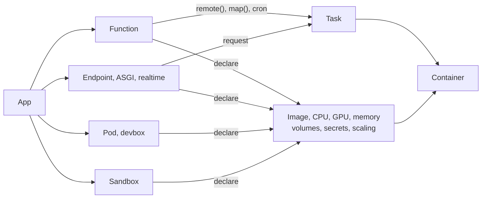

A workspace holds [apps](/concepts/apps), and an app holds workloads. A
workload's decorator is its whole definition: image, CPU, GPU, memory,
volumes, secrets, schedule, and scaling. A remote call or request to a
workload is a [task](/concepts/tasks-and-logs), which keeps its status, result,
and logs after its container stops.

## Pick a workload

<CardGroup cols={2}>
  <Card title="Function" href="/concepts/functions">
    Python that runs in a remote container and returns its result, one call at
    a time or fanned out over a batch. Batch jobs, background work, GPU tasks.
  </Card>
  <Card title="Schedule" href="/concepts/schedules">
    A function with `cron`, run on a timer.
  </Card>
  <Card title="Endpoint, ASGI app, realtime handler" href="/concepts/endpoints">
    A function behind an HTTPS URL, a FastAPI or Starlette app, or a WebSocket
    handler, with bearer-token auth by default.
  </Card>
  <Card title="Pod" href="/concepts/pods">
    A container command you already have, such as a model server, scaled by
    hand.
  </Card>
  <Card title="Devbox" href="/concepts/dev-machines">
    A container you log into over SSH, with a disk that keeps its files, for
    coding agents and remote editors.
  </Card>
  <Card title="Sandbox" href="/concepts/sandboxes">
    A container your code creates on demand, with process control, a
    filesystem API, ports, and snapshots.
  </Card>
</CardGroup>

Containers start when work arrives and stop when
[idle](/concepts/cold-starts#keep-containers-warm). A deploy starts every kind
except sandboxes.

## Develop, test, deploy

The same code moves through three stages without changes. Calling the
function, or `.local()`, runs it in your own process, in seconds and for free;
the decorator's image, volumes, secrets, GPU, and retries don't apply.
`lazycloud run`, or `.remote()`, builds the image if it changed, uploads your
working tree, and makes one call in a cloud container, which proves the
image, GPU, and secrets; nothing is deployed, and the container stops after
its `keep_warm` window. `lazycloud serve` runs the workload in a cloud
container until Ctrl+C and syncs each saved file into it, so an edit costs a
file sync instead of a build; functions reload after in-flight calls finish,
and endpoints restart their server on the same preview URL. `lazycloud deploy`
keeps the workload running after your terminal is off. Containers start on
demand and [scale](/concepts/scaling), endpoints get a stable URL, schedules
start firing, and each deploy that changes a workload records a new version.
`run` and `deploy` take [`--json`](/cli/overview) and exit nonzero on failure,
so an agent or a script can drive the loop.

## Where a call goes

`.remote()`, `.spawn()`, `.map()`, and `lazycloud run` pick a target in order:

1. A preview of this function started from this machine and workspace.
2. From your machine, a fresh run of the working tree.
3. Inside a LazyCloud container, the deployed function.

A container has no working tree, so a deployed endpoint reaches the function
it calls because deploying the app deployed both.

Endpoint clients choose explicitly. `request(...)` calls the preview if one is
running and the deployment otherwise, `target("deployed")` skips the preview,
and `target("served")` never falls back. `deployment_name` and
`deployment_version` pin one deployment.

## What gets uploaded

`run`, `serve`, and `deploy` upload the current directory, normally the project
root. `--source-root` on `deploy` and `--sync-dir` on `serve` pick another.
The first upload writes a `.lazycloudignore`, in gitignore syntax, for you to
edit and commit. `.git`, `.venv`, `__pycache__`, `*.pyc`, `.env`, and
`.lazycloud/` never upload. Datasets and model weights belong in
[volumes](/concepts/volumes). Your code isn't part of the
[image](/concepts/images), so editing it never triggers a rebuild; changing a
dependency does.
