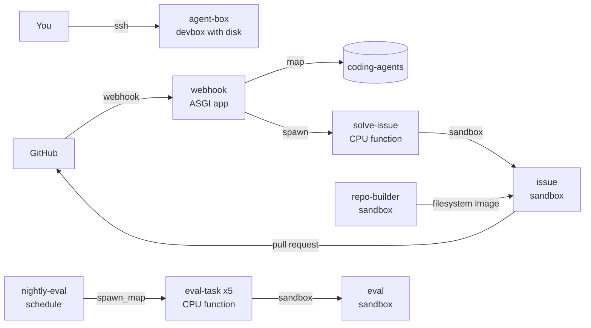

import ExampleSetup from '/snippets/example-setup.mdx';

Three ways to use a coding agent on one repository. A devbox you SSH into to
work alongside Claude Code or Codex. A GitHub webhook that hands each issue
labeled `agent` to Claude Code in its own sandbox and opens a pull request
with the result. And a nightly eval that runs the agent on five small tasks in
parallel sandboxes and posts the pass rate and spend.

## How it fits together



| Workload | Kind | What it does | Why it runs there |
| --- | --- | --- | --- |
| `agent-box` | devbox | A container you reach over SSH with Claude Code, Codex, tmux and `gh` installed | Its root filesystem is a 50 GiB disk, so clones and logins survive a restart; it runs while you are connected, plus an hour |
| `webhook` | ASGI app | Checks GitHub's signature, claims the issue and starts a worker | GitHub needs one stable HTTPS route that answers in under ten seconds |
| `solve-issue` | CPU function | Starts a sandbox on the repository snapshot, runs the agent and your tests, pushes a branch and opens the pull request | One call per issue gives each run its own logs, result and time limit; at most three run at once and 20 wait |
| `repo-builder` | sandbox | Clones the repository, runs setup and publishes its filesystem as an image | The only agent sandbox with open network |
| `issue`, `eval` | sandbox | Run the agent's commands | Each reaches only the model API's address range and is terminated when its run ends |
| `nightly-eval` | schedule | Fans five tasks out with `spawn_map` and posts the report | The tasks are independent, so each gets its own `eval-task` call and sandbox |

The `coding-agents` map holds the snapshot record and a claim per issue in
progress. Each secret reaches only the workloads that use it;
`GITHUB_WEBHOOK_SECRET` reaches only the webhook. With no labeled issues and
no SSH session, only the map and the devbox disk cost anything, plus one eval
a night, and `AGENT_MAX_BUDGET_USD` caps each run's model spend at $5.

## Run it

<Steps>
  <Step title="Download">
    <ExampleSetup />

    ```bash
    lazycloud example download coding-agents
    cd coding-agents
    uv sync
    uv run lazycloud login
    ```
  </Step>
  <Step title="Configure">
    Set `REPOSITORY` in `coding_agents/settings.py`; `SETUP_COMMAND` and
    `TEST_COMMAND` default to a uv project with pytest. The script asks for an
    [Anthropic API key](https://platform.claude.com/settings/keys), a GitHub
    token with read and write access to contents, issues and pull requests,
    and a webhook secret such as `openssl rand -hex 32`.

    ```bash
    uv run python -m coding_agents.configure
    ```
  </Step>
  <Step title="Deploy">
    ```bash
    uv run lazycloud deploy coding_agents.app:app
    uv run python -m coding_agents.snapshot
    ```

    The deploy prints the webhook URL. In the repository's settings, add a
    webhook with that URL followed by `/github`, content type
    `application/json`, the secret you stored, and Issues events only.
  </Step>
  <Step title="Use">
    Create an `agent` label, open an issue, and apply the label. A pull
    request from `agent/issue-<number>` follows, with the agent's summary,
    the test verdict, the turns and the spend.

    ```bash
    uv run lazycloud task list --app coding_agents
    uv run lazycloud task logs <task-id>
    ```

    `uv run lazycloud devbox agent-box ssh` connects to the devbox; inside,
    clone the repository, start `tmux` and run `claude` or `codex`.
    `uv run lazycloud run coding_agents.app:nightly_eval` runs the eval now
    instead of waiting for 06:00 UTC.
  </Step>
</Steps>

## A devbox with a disk

A [devbox](/concepts/dev-machines) is a container you SSH into; the secrets
arrive as environment variables, so `claude` and `gh` work on the first
connection, and the idle window counts from your last SSH connection.

```python coding_agents/app.py
devbox = app.devbox(
    "agent-box",
    image=Image(python_version="3.12")
    .add_commands(
        [
            "apt-get update && DEBIAN_FRONTEND=noninteractive apt-get install -y "
            "--no-install-recommends gh jq ripgrep tmux && rm -rf /var/lib/apt/lists/*"
        ]
    )
    .add_python_packages(["uv==0.11.32"]),
    agent_harnesses=[AgentHarness.ClaudeCode, AgentHarness.Codex],
    disk="50Gi",
    cpu=2,
    memory="8Gi",
    keep_warm=60 * 60,
    secrets=[ANTHROPIC_API_KEY.name, GITHUB_TOKEN.name],
)
```

## Sandboxes that reach only the model API

A [sandbox](/concepts/sandboxes) runs the agent's commands; `allow_list`
holds address ranges, DNS included, so the function pins `api.anthropic.com`
in the sandbox's `/etc/hosts`, and the agent runs as an unprivileged user
that cannot change it. The issue sandbox is the same with
`image=Image.from_id(snapshot.image_id)`, declared at run time.

```python coding_agents/app.py
eval_sandbox = app.sandbox(
    name="eval",
    image=agent_image,
    cpu=0.5,
    memory="1Gi",
    allow_list=[MODEL_API_RANGE],
    keep_warm_seconds=300,
    preemptible=False,
)
```

## A filesystem image as the snapshot

A sandbox's filesystem can become an [image](/concepts/sandboxes#snapshot-and-restore),
which is how the repository and its dependencies reach offline sandboxes.

```python coding_agents/snapshot.py
        revision = run_checked(
            instance,
            as_agent("git", "rev-parse", "HEAD", "--abbrev-ref", "HEAD"),
            cwd=REPO_DIR,
            env=AGENT_ENV,
            timeout_seconds=30,
        )
        commit, branch = revision.split()
        image_id = instance.create_image_from_filesystem()
    return RepoSnapshot(image_id=image_id, commit=commit, branch=branch)
```

## A claim in a map, then spawn

A [map](/concepts/queues-maps#map) entry with a two-hour TTL claims the issue
before `.spawn()`, so a relabel or a redelivery keeps the run already going.
The webhook is `authorized=False`, since GitHub cannot send a LazyCloud token;
every delivery carries the secret's signature instead.

```python coding_agents/app.py
def start_issue(job: IssueJob) -> str | None:
    """Claim the issue and start a worker on it; an issue already claimed keeps its run.

    The webhook runs one request at a time in one container, so the check and
    the claim cannot race.
    """
    if job.claim_key in STATE:
        return None
    STATE.set(job.claim_key, job.number, ttl=CLAIM_TTL_SECONDS)
    try:
        return solve.spawn(job).task_id
    except SdkError:
        del STATE[job.claim_key]
        raise
```

## A schedule that fans out

A [schedule](/concepts/schedules) is a function with `cron`; `spawn_map`
starts one `eval-task` call per task, and `call.result(wait=True)` collects
each outcome, with a failed call counted as a failed task.

```python coding_agents/app.py
@app.function(
    name="nightly-eval",
    cron="0 6 * * *",
    image=function_image,
    cpu=0.125,
    memory="256Mi",
    timeout_seconds=AGENT_TIMEOUT_SECONDS + 30 * 60,
    retries=0,
    preemptible=False,
    secrets=[GITHUB_TOKEN.name],
)
def nightly_eval() -> EvalReport:
    names = task_names()
    calls = eval_task.spawn_map([(name,) for name in names])
```

## Adapt it

- Another stack needs its tools in `agent_image` and its commands in
  `SETUP_COMMAND` and `TEST_COMMAND`, for example `npm ci` and `npm test`.
- `AGENT_MODEL` takes `opus` or a full model name; the eval is the place to
  compare models on cost and pass rate before switching.
- A CI job that runs `uv run python -m coding_agents.snapshot` after each
  merge keeps pull requests close to the default branch.

## Clean up

```bash
uv run lazycloud app delete coding_agents
uv run lazycloud disk delete agent-box
uv run lazycloud ssh-config --prune
uv run lazycloud secret delete ANTHROPIC_API_KEY
uv run lazycloud secret delete GITHUB_TOKEN
uv run lazycloud secret delete GITHUB_WEBHOOK_SECRET
uv run python -c "from coding_agents.app import STATE; STATE.delete()"
```

Remove the webhook in the repository's settings, and delete the
`agent/issue-*` branches you no longer need. Snapshot images stay in the
workspace, since the CLI has no command to delete an image.
`deployment stop nightly-eval` pauses only the eval.
