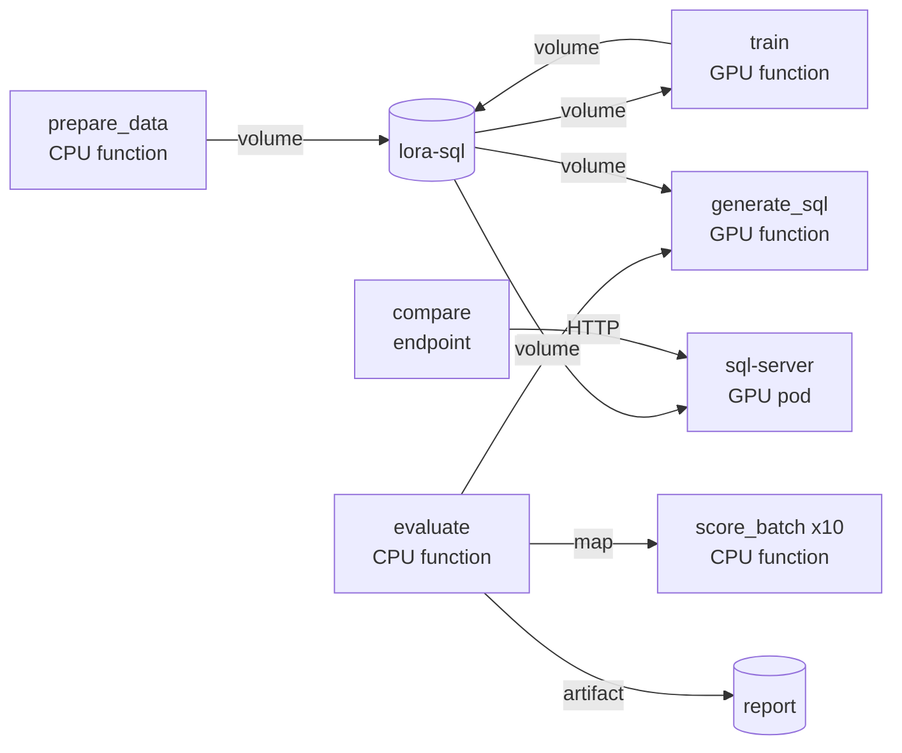

import ExampleSetup from '/snippets/example-setup.mdx';

The project teaches `Qwen/Qwen2.5-Coder-1.5B-Instruct` to answer a question
about a database with one SQLite query. It trains a LoRA adapter on a public
text-to-SQL dataset, runs every query the base model and the tuned model
write, and counts how often each returns the right rows. You get a Markdown
report with both accuracies, a vLLM server that hosts both models behind one
OpenAI-compatible URL, and an endpoint that shows their answers side by side.

## How it fits together



| Workload | Kind | What it does | Why it runs there |
| --- | --- | --- | --- |
| `prepare_data` | CPU function | Downloads the base weights and filters the dataset into the volume | Network and SQLite work needs no GPU |
| `train` | GPU function | Trains one adapter and saves checkpoints as it goes | A 1.5B model in bf16 fits an L4 or A10G; a preempted call resumes from its last checkpoint |
| `generate_sql` | GPU function | Answers every held-out question with the base weights, then with the adapter | One vLLM engine serves both in one container |
| `score_batch` | CPU function | Runs 50 predicted queries against throwaway SQLite databases | Fanned out with `.map` over up to ten containers |
| `evaluate` | CPU function | Calls the two steps above and saves the report as an artifact | A quarter CPU that mostly waits |
| `sql-server` | GPU pod | vLLM's own OpenAI-compatible server with the adapter loaded | A server command is what a pod runs; `authorized=True` checks the bearer token before a request wakes the GPU |
| `compare` | endpoint | Asks both models and runs both answers | A quarter CPU that scales to zero |

One volume holds the weights, data, checkpoints and adapters. Two secrets,
`SQL_SERVER_URL` and `SQL_SERVER_TOKEN`, reach only `compare`. Nothing holds
a GPU while idle. The volume holds about 3 GB of base weights plus the
adapter and two checkpoints per run.

## Run it

<Steps>
  <Step title="Download">
    <ExampleSetup />

    ```bash
    lazycloud example download lora-fine-tune
    cd lora-fine-tune
    uv sync
    uv run lazycloud login
    ```

    PyTorch, PEFT and vLLM sit in the `gpu` dependency group and the dataset
    tools in `data`; only the remote images install them.
  </Step>
  <Step title="Deploy">
    ```bash
    uv run lazycloud deploy lora_sql.app:app
    ```

    Deploying starts nothing. The pod waits for its first request and the
    functions wait for calls.
  </Step>
  <Step title="Train and evaluate">
    ```bash
    uv run lazycloud run lora_sql.data:prepare_data
    uv run lazycloud run lora_sql.train:train
    uv run lazycloud run lora_sql.evaluate:evaluate
    ```

    `evaluate` returns both accuracies and a `report_url`. A second run with
    other settings gets its own name:

    ```bash
    uv run lazycloud run lora_sql.train:train sql-r32 '{"lora_rank": 32, "lora_alpha": 64}'
    uv run lazycloud run lora_sql.evaluate:evaluate sql-r32
    ```
  </Step>
  <Step title="Configure">
    Create an access token in the dashboard under Settings, then Tokens. The
    script asks for it and for the `sql-server` URL from the deploy output,
    the one whose host ends in `-8000`, and stores both as secrets.

    ```bash
    uv run python -m lora_sql.configure
    ```
  </Step>
  <Step title="Use">
    ```bash
    uv run python -m lora_sql.ask "Which customers spent more than 100 in total?"
    ```

    `--database` points at your own file of `CREATE TABLE` and `INSERT`
    statements. The first request after an idle period starts the GPU pod.
    Any OpenAI client can call the server directly, with your token as the
    API key and `base` or `tuned` as the model.
  </Step>
</Steps>

## One volume for every step

A [volume](/concepts/volumes) mounts at the same path in every container, so
the base weights download once and training, evaluation and serving read
them from storage.

```python lora_sql/resources.py
# Base weights, prepared data, checkpoints and adapters share one volume, so
# every container reads them from storage instead of the network.
STORAGE = Path("/lora-sql")
storage = Volume("lora-sql", str(STORAGE))
BASE_MODEL_DIR = STORAGE / "base-model"
DATA_DIR = STORAGE / "data"
RUNS_DIR = STORAGE / "runs"
```

## A GPU function that resumes

A [GPU](/concepts/resources#request-a-gpu) list takes whichever card is free
first, and a preempted call restarts from the newest complete checkpoint on
the volume.

```python lora_sql/train.py
@app.function(
    image=gpu_image,
    gpu=GPUS,
    cpu=4,
    memory="16Gi",
    volumes=[storage],
    timeout_seconds=3 * 3600,
    # A failure here would fail again; preemption restarts the call anyway,
    # and the run resumes from its last checkpoint.
    retries=0,
)
def train(run: str = DEFAULT_RUN, settings: TrainingConfig | None = None) -> TrainingResult:
```

## Fan out scoring with `.map`

[`.map`](/concepts/functions#run-many-inputs-at-once) runs one call per batch, the
[autoscaler](/concepts/scaling#more-containers) spreads them over up to ten
containers, and a batch that fails after its retries yields `None`.

```python lora_sql/evaluate.py
@app.function(
    image=cpu_image,
    cpu=0.25,
    memory="256Mi",
    timeout_seconds=300,
    retries=2,
    max_pending_tasks=200,
    autoscaler=Autoscaler(max_containers=10, tasks_per_container=1),
)
def score_batch(cases: list[ScoringCase]) -> list[bool]:
    return [execution_match(case.context, case.reference_sql, case.predicted_sql) for case in cases]
...
def score(cases: Sequence[ScoringCase]) -> list[bool]:
    """Run each predicted query against its database, in parallel batches."""
    results = list(score_batch.map([(list(batch),) for batch in batched(cases, SCORING_BATCH)]))
    failed = sum(result is None for result in results)
    if failed:
        raise RuntimeError(f"{failed} of {len(results)} scoring batches failed")
    return [correct for result in results if result is not None for correct in result]
```

## The report as an artifact

An [artifact](/concepts/artifacts) saved by a task gets a public link that
lasts up to seven days, or less when your plan keeps artifacts for a shorter
time.

```python lora_sql/evaluate.py
    with tempfile.TemporaryDirectory() as directory:
        path = Path(directory) / f"evaluation-{run}.md"
        path.write_text(report, encoding="utf-8")
        artifact = Artifact.file(path, content_type="text/markdown")
        artifact.save()
        report_url = artifact.public_url(expires=REPORT_DAYS * 24 * 3600)
```

## A pod behind an endpoint

`sql-server` is a [pod](/concepts/pods) that runs `vllm serve` with
`health_check_path="/health"`, stops after five idle minutes and checks a
LazyCloud token on every request. A container holds no credential of its
own, so the [endpoint](/concepts/endpoints) reads the pod's URL and a token
from [secrets](/concepts/secrets).

```python lora_sql/compare.py
@app.endpoint(
    name="compare",
    route="/compare",
    methods=["POST"],
    image=cpu_image,
    cpu=0.25,
    memory="256Mi",
    concurrency=8,
    keep_warm=120,
    timeout_seconds=300,
    secrets=[server_url.name, server_token.name],
)
async def compare(question: Question, context: Context) -> Comparison:
```

## Adapt it

- `BASE_MODEL` in `resources.py` picks another model. A 7B model needs a
  larger GPU, such as `GpuType.L40S`, in `GPUS`.
- `usable_examples` takes any rows with a question, the database statements
  and reference SQL. Your own query logs make a better training set for your
  own database.
- `SERVED_RUN` in `serve.py` picks the adapter the server loads. Change it
  and redeploy to promote a run.

## Clean up

```bash
uv run lazycloud app delete lora_sql
uv run lazycloud volume delete lora-sql
uv run lazycloud secret delete SQL_SERVER_URL
uv run lazycloud secret delete SQL_SERVER_TOKEN
```

Then delete the access token in the dashboard. Keeping the volume keeps the
base weights, datasets and adapters for the next run.
