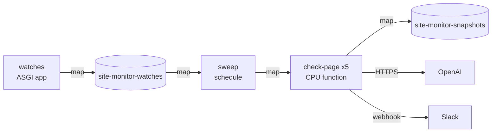

import ExampleSetup from '/snippets/example-setup.mdx';

Every 15 minutes a sweep opens each watched page in headless Chromium, pulls
out its readable text and compares it with the previous check. When the text
differs, an OpenAI model decides whether a person would care and writes a
one-line summary, and changes that matter post to Slack. A small HTTP API
adds, lists and removes the pages.

## How it fits together



| Workload | Kind | What it does | Why it runs there |
| --- | --- | --- | --- |
| `sweep` | schedule | Lists the watches every 15 minutes and fans them out | It only lists pages and waits, so a quarter CPU is enough; each run is a task with its own logs and result |
| `check-page` | CPU function | Loads one page in Chromium, diffs it, asks the judge and posts to Slack | Each page is an independent call that fails and retries alone; four run per container on 2 CPUs and 4 GiB, over up to five containers |
| `watches` | ASGI app | FastAPI routes that manage the watch list | LazyCloud's bearer-token auth guards it, so the API needs no auth code; it stops a minute after the last request |

Two maps hold the watch list and the last text seen for each page; each
entry is small and keyed by watch, so a map fits better than a volume. The
`OPENAI_API_KEY` and `SLACK_WEBHOOK_URL` secrets reach only `check-page`.
Between sweeps nothing runs, and the model call happens only when a page's
text changed.

## Run it

<Steps>
  <Step title="Download">
    <ExampleSetup />

    ```bash
    lazycloud example download site-monitor
    cd site-monitor
    uv sync
    uv run lazycloud login
    ```

    Playwright, trafilatura and the OpenAI client sit in the `check`
    dependency group, which only the remote image installs.
  </Step>
  <Step title="Configure">
    The script asks for an OpenAI API key and a Slack
    [incoming webhook](https://api.slack.com/messaging/webhooks) URL and
    stores both as secrets.

    ```bash
    uv run python -m site_monitor.configure
    ```
  </Step>
  <Step title="Deploy">
    ```bash
    uv run lazycloud deploy site_monitor.app:app
    ```

    The deploy builds both images, registers the schedule and prints the
    `watches` URL. The browser image takes longer the first time because it
    installs Chromium.
  </Step>
  <Step title="Use">
    Requests to the API need an [access token](/platform/auth#ci-and-scripts)
    for the workspace. With `LAZYCLOUD_TOKEN` set and the printed URL in
    place of `<watches-url>`:

    ```bash
    curl --fail-with-body "<watches-url>/watches" \
      -H "Authorization: Bearer $LAZYCLOUD_TOKEN" \
      -H "Content-Type: application/json" \
      -d '{"url": "https://example.com/pricing", "label": "Pricing", "focus": "price or plan changes"}'
    ```

    The first sweep stores a baseline for a new page. To check now instead
    of waiting for the next quarter hour:

    ```bash
    uv run lazycloud run site_monitor.app:sweep
    ```

    The result lists each page's outcome, one of `baseline`, `unchanged`,
    `minor_change` and `alerted`, and the pages that failed.
    `uv run lazycloud task list --app site_monitor` shows each page's logs
    and retries.
  </Step>
</Steps>

## A schedule that fans out with `.map`

A [schedule](/concepts/schedules) is a function with `cron`; `.map` yields
`None` for a page whose retries ran out, and a sweep still running at the
next quarter hour delays that run rather than overlapping it.

```python site_monitor/app.py
@app.function(
    name="sweep",
    image=image,
    cron="*/15 * * * *",
    cpu=0.25,
    memory="256Mi",
    timeout_seconds=900,
    retries=1,
)
def sweep() -> SweepReport:
    # Retries keep the task ID, so a retried sweep skips the checks it finished.
    run_id = current_task_id()
    if not run_id:
        raise RuntimeError("run the sweep remotely: uv run lazycloud run site_monitor.app:sweep")
    watches = load_watches(WATCHES)
    results = list(check_page.map([(watch, run_id) for watch in watches]))
    return SweepReport(
        results=[result for result in results if result is not None],
        failed=[
            str(watch.url) for watch, result in zip(watches, results, strict=True) if result is None
        ],
    )
```

## A browser function with an autoscaler

The [autoscaler](/concepts/scaling#more-containers) adds a container per
four queued pages, up to five, so at most 20 browsers run at once, and
`max_pending_tasks` leaves room for a retried sweep that submits every page
again.

```python site_monitor/app.py
@app.function(
    name="check-page",
    image=browser_image,
    cpu=2,
    memory="4Gi",
    concurrency=4,
    autoscaler=Autoscaler(max_containers=5, tasks_per_container=4),
    # A retried sweep submits every page again while the first attempt's checks may still queue.
    max_pending_tasks=2 * MAX_WATCHES,
    timeout_seconds=180,
    retries=2,
    retry_delay_seconds=15,
    secrets=[OPENAI_API_KEY.name, SLACK_WEBHOOK_URL.name],
)
def check_page(watch: Watch, run_id: str) -> CheckResult:
```

## Maps for watches and snapshots

A [map](/concepts/queues-maps#map) key expires after seven days unless set
with `ttl=0`, so watches get `ttl=0` and snapshots keep the default, which
lets a snapshot left by a removed watch expire on its own.

```python site_monitor/api.py
    @api.post("/watches")
    def add_watch(request: WatchRequest) -> Watch:
        watch = Watch.from_request(request)
        if watch.id not in watches and len(watches) >= MAX_WATCHES:
            raise HTTPException(409, f"already watching {MAX_WATCHES} pages")
        watches.set(watch.id, watch.model_dump(mode="json"), ttl=0)
        return watch
```

## One alert per run across retries

A [retried](/concepts/functions#function-options) call reruns from the top,
so the snapshot carries the run's ID; a retry in the same run finds its own
snapshot, resends an alert that failed to deliver and skips one already
sent.

```python site_monitor/checks.py
    stored = snapshots.get(watch.id)
    previous = Snapshot.model_validate(stored) if stored is not None else None
    if previous is not None and previous.run_id == run_id:
        snapshot = previous
    else:
        snapshot = _observe(watch, run_id, previous, read_page, judge)
        snapshots[watch.id] = snapshot.model_dump(mode="json")
    if snapshot.pending_alert is not None:
        notify(watch, snapshot.pending_alert)
        snapshot = snapshot.model_copy(update={"pending_alert": None})
        snapshots[watch.id] = snapshot.model_dump(mode="json")
    return CheckResult(watch_id=watch.id, url=str(watch.url), outcome=snapshot.outcome)
```

## An ASGI app behind platform auth

An [ASGI app](/concepts/endpoints#asgi-applications) is authorized by
default, so a plain FastAPI app bound to a module attribute needs no auth
code of its own.

```python site_monitor/app.py
api = create_api(WATCHES, SNAPSHOTS)
service = app.asgi(
    name="watches",
    image=image,
    cpu=0.25,
    memory="256Mi",
    concurrent_requests=8,
    keep_warm_seconds=60,
)(api)
```

## Adapt it

- A `selector` such as `#pricing-table` watches one element, and `focus`
  tells the judge what counts, for example "new job postings in Europe".
- `cron` sets the interval; `"0 * * * *"` checks hourly and cuts the cost
  fourfold. `MODEL` in `judge.py` picks the OpenAI model.
- `notify` can be any function that takes a watch and a summary, such as an
  email or a ticket in your issue tracker.

## Clean up

```bash
uv run lazycloud app delete site_monitor
uv run lazycloud secret delete OPENAI_API_KEY
uv run lazycloud secret delete SLACK_WEBHOOK_URL
uv run python -c "from site_monitor.app import SNAPSHOTS, WATCHES; WATCHES.delete(); SNAPSHOTS.delete()"
```

`deployment stop sweep` pauses only the schedule and keeps the API and the
stored pages.
