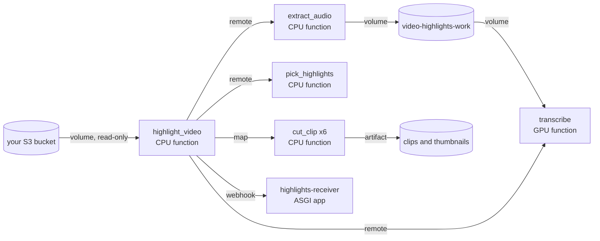

import ExampleSetup from '/snippets/example-setup.mdx';

You give the pipeline the key of a video in your S3 bucket. It transcribes
the speech, has an OpenAI model choose chapters and the moments worth
sharing, and cuts each one into an MP4 clip with a thumbnail. The run returns
a manifest of share links and posts a signed callback to your app when it
finishes.

## How it fits together



| Workload | Kind | What it does | Why it runs there |
| --- | --- | --- | --- |
| `highlight_video` | CPU function | Checks the video, calls each step in turn and writes the manifest | It mostly waits, so a quarter CPU is enough; it is the only workload with a `callback_url` |
| `extract_audio` | CPU function | Reads the video from S3 and writes a FLAC file to the volume | Decoding a multi-gigabyte file is I/O and ffmpeg work, not GPU time |
| `transcribe` | GPU function | Runs Whisper `large-v3-turbo` on the FLAC file | The weights are baked into the image, so a new container never fetches them; an L4, A10G or T4 fits |
| `pick_highlights` | CPU function | Sends the transcript to the OpenAI API with structured outputs | The only step with the `OPENAI_API_KEY` secret; it retries on rate limits |
| `cut_clip` | CPU function | Re-encodes one clip and its thumbnail and saves both as artifacts | Each highlight is independent, so `.map` runs up to six in parallel |
| `highlights-receiver` | ASGI app | Hosts the callback route when your own app is not ready | Public, since callbacks carry a signature instead of a token |

The bucket mounts read-only with keys held in two secrets, and a workspace in
a [connected AWS account](/platform/compute#your-own-aws-account) reads a
bucket in the same region without leaving it. The volume keeps each video's
transcript. Every function scales to zero between runs, and the GPU bills
only for transcription.

## Run it

<Steps>
  <Step title="Download">
    <ExampleSetup />

    ```bash
    lazycloud example download video-highlights
    cd video-highlights
    uv sync
    uv run lazycloud login
    ```
  </Step>
  <Step title="Configure">
    Create an IAM user with a policy that can only list and read the bucket,
    with `my-video-bucket` replaced by yours:

    ```json
    {
      "Version": "2012-10-17",
      "Statement": [
        {"Effect": "Allow", "Action": ["s3:ListBucket"], "Resource": "arn:aws:s3:::my-video-bucket"},
        {"Effect": "Allow", "Action": ["s3:GetObject"], "Resource": "arn:aws:s3:::my-video-bucket/*"}
      ]
    }
    ```

    Put the bucket's name and region in `video_highlights/settings.py`
    (`BUCKET_NAME`, `BUCKET_REGION`), then store that user's key pair and an
    OpenAI API key as secrets. The script also creates the workspace's
    callback signing key if there is none yet.

    ```bash
    uv run python -m video_highlights.configure
    ```
  </Step>
  <Step title="Deploy">
    Deploy the receiver first to get its URL:

    ```bash
    uv run lazycloud deploy video_highlights.inbox:inbox
    ```

    Set `CALLBACK_URL` in `settings.py` to the printed URL followed by
    `/video-highlights`, or leave it `None` to skip callbacks, then deploy the
    pipeline:

    ```bash
    uv run lazycloud deploy video_highlights.pipeline:app
    ```

    The GPU image takes longest, since it downloads about 1.6 GB of Whisper
    weights.
  </Step>
  <Step title="Use">
    ```bash
    aws s3 cp keynote.mp4 s3://my-video-bucket/talks/keynote.mp4
    uv run lazycloud --json run video_highlights.pipeline:highlight_video talks/keynote.mp4
    ```

    `--json` sends the arguments as JSON, so the result and the callback both
    carry the manifest. A rerun of the same video reuses the saved transcript
    and skips the GPU. The receiver's log shows each verified callback:

    ```bash
    uv run lazycloud logs --deployment highlights-receiver --follow
    ```
  </Step>
</Steps>

## A bucket mount and a volume

A [cloud bucket](/concepts/volumes#mount-an-existing-cloud-bucket) mounts
like a volume, here read-only so no step can change your source files, and a
volume keeps the transcripts between runs.

```python video_highlights/pipeline.py
source = CloudBucket(
    settings.BUCKET_NAME,
    str(VIDEOS),
    CloudBucketConfig(
        access_key=BUCKET_ACCESS_KEY.name,
        secret_key=BUCKET_SECRET_KEY.name,
        region=settings.BUCKET_REGION,
        read_only=True,
    ),
)
work = Volume("video-highlights-work", str(WORK))
```

## A coordinator with a callback

A [function](/concepts/functions) can call other deployed functions with
`.remote()` and fan out with `.map`; `preemptible=False` keeps a reclaimed
machine from running the steps twice, and `callback_url` names where the
result goes.

```python video_highlights/pipeline.py
@app.function(
    image=ffmpeg_image,
    volumes=[source, work],
    cpu=0.25,
    memory="1Gi",
    concurrency=4,
    timeout_seconds=3 * 3600,
    retries=0,
    preemptible=False,
    callback_url=settings.CALLBACK_URL,
)
def highlight_video(
    video_key: str, model: str = settings.OPENAI_MODEL, max_highlights: int = 6
) -> HighlightRun:
    """Run every step for one video and return its manifest and share link."""
    if not 1 <= max_highlights <= MAX_HIGHLIGHTS:
        raise ValueError(f"max_highlights must be between 1 and {MAX_HIGHLIGHTS}")
    video = inspect_video(VIDEOS, video_key)
    transcript = saved_transcript(video)
    if transcript is None:
        extract_audio.remote(video)
        transcript = transcribe.remote(video)
    plan = pick_highlights.remote(transcript, model, max_highlights)
    picks = list(enumerate(plan.highlights, start=1))
    clips = list(cut_clip.map([(video, number, pick) for number, pick in picks]))
```

## Share links as artifacts

An [artifact](/concepts/artifacts) saved on the current task returns a link
anyone can open, for seven days at most.

```python video_highlights/pipeline.py
def share(path: Path, content_type: str) -> str:
    """Save a file as an artifact of the current task and return a public link."""
    artifact = Artifact.file(path, content_type=content_type)
    artifact.save()
    return artifact.public_url(expires=SHARE_SECONDS)
```

## A signed callback

When a run with a `callback_url` is retried or ends, LazyCloud POSTs a JSON
[event](/concepts/tasks-and-logs#callbacks) signed with the workspace's
`LAZYCLOUD_CALLBACK_SIGNING_KEY`, retried up to three times with an
`Idempotency-Key` header.

```python video_highlights/receiver.py
def signature_matches(key: str, body: bytes, timestamp: str, signature: str, now: float) -> bool:
    """Check X-Task-Signature: hex HMAC-SHA256 of the base64 body, a colon and the timestamp."""
    if not timestamp.isdecimal() or abs(now - int(timestamp)) > MAX_CLOCK_SKEW_SECONDS:
        return False
    message = base64.b64encode(body) + b":" + timestamp.encode()
    expected = hmac.new(key.encode(), message, hashlib.sha256).hexdigest()
    return hmac.compare_digest(expected, signature)
```

## Adapt it

- `MAX_HIGHLIGHTS`, `MIN_CLIP_SECONDS` and `MAX_CLIP_SECONDS` in
  `highlights.py` set the clip count and length limits; `INSTRUCTIONS` in
  `llm.py` decides what counts as a highlight.
- `WHISPER_MODEL` in `pipeline.py` picks the transcription model, and
  `CloudBucketConfig` takes an `endpoint` for another S3-compatible store.
- A schedule that lists new keys under a prefix and spawns `highlight_video`
  for each one turns the pipeline into a drop folder.

## Clean up

```bash
uv run lazycloud app delete video_highlights
uv run lazycloud app delete video_highlights_inbox
uv run lazycloud volume delete video-highlights-work
uv run lazycloud secret delete VIDEO_BUCKET_ACCESS_KEY
uv run lazycloud secret delete VIDEO_BUCKET_SECRET_KEY
uv run lazycloud secret delete OPENAI_API_KEY
```

Clips, thumbnails and manifests expire with your plan's retention.
`uv run lazycloud artifact list` and `artifact delete` remove them sooner.
Your bucket and its videos are unchanged, since the pipeline mounts it
read-only.
